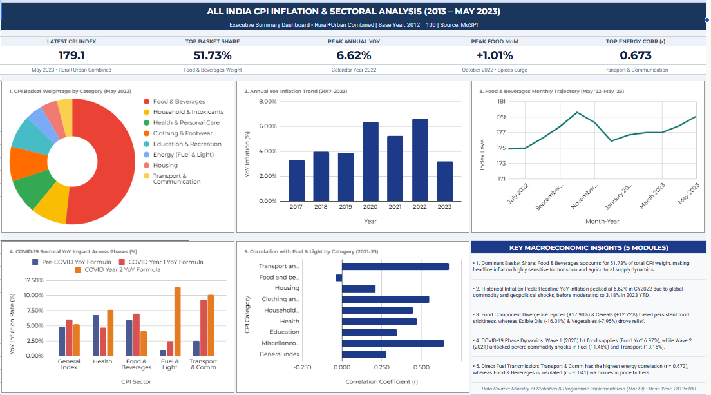

# 📊 All-India CPI Inflation & Sectoral Analysis (2013–2023)

An end-to-end economic data analysis and executive dashboard examining 10+ years of India's Consumer Price Index (CPI) data across Rural, Urban, and Combined sectors (Base Year: 2012 = 100).

## 🔗 Live Interactive Workbook
 [Open View-Only Google Sheets Dashboard & Formulas](https://docs.google.com/spreadsheets/d/14Cdi2SmbYj7l80mcZSJelkbiXeeg0jOBCEns_si7vH4/edit?usp=sharing)
 Raw Dataset: [`all_india_cpi_2013_2023.csv`](all_india_cpi_2013_2023.csv) (372 rows × 30 columns | Jan 2013 – May 2023 | Source: MoSPI)

---

## 🔍 Key Business & Economic Insights

1. CPI Basket Structure (May 2023): Food & Beverages accounts for 51.73% of the underlying leaf category index sum (45.88% under official MoSPI weights), making household inflation heavily sensitive to food supply shocks.
2. Annual Inflation Trajectory (2017–2023): Annual YoY CPI inflation peaked in 2022 at 6.62% (with monthly inflation hitting 7.79% in April 2022) due to global edible oil/crude supply disruptions and domestic heatwaves.
3. Food Sub-Category Divergence (May 2022 – May 2023): Monthly food inflation peaked in October 2022 (+1.01% MoM) before cooling in December 2022 (-1.35% MoM). Over the 12-month window, Spices (+33.1 pts / +17.9%) and Cereals (+19.6 pts / +12.7%) drove inflation, while Oils & Fats (-32.4 pts / -16.0%) corrected sharply.
4. COVID-19 Sectoral Waves: Post-March 2020 lockdowns triggered an immediate Food & Beverages surge (7.23% in Year 1), whereas Transport & Communication jumped nearly 4x (9.19% in Year 1; 10.92% in Year 2) and Health spiked during the 2021 second wave (7.73%).
5. Energy Pass-Through (2021–2023): Using Fuel & Light as an energy proxy, Transport & Communication showed the strongest MoM correlation (r = 0.67), followed by Non-alcoholic Beverages (r = 0.65) and Oils & Fats (r = 0.56).

---

## 🛠️ Methodology & Data Cleaning
 Handled missing lockdown-era survey records (April–May 2020) and non-numeric Rural Housing entries without skewing period averages.
 Isolated 23 leaf consumption categories to prevent double-counting pre-aggregated group totals (`Food and beverages`, `Clothing and footwear`, `Miscellaneous`, `General index`).
 Built dynamic formulas (`AVERAGEIFS`, `INDEX-MATCH`, `CORREL`, `FILTER`) powering a consolidated multi-chart dashboard.
